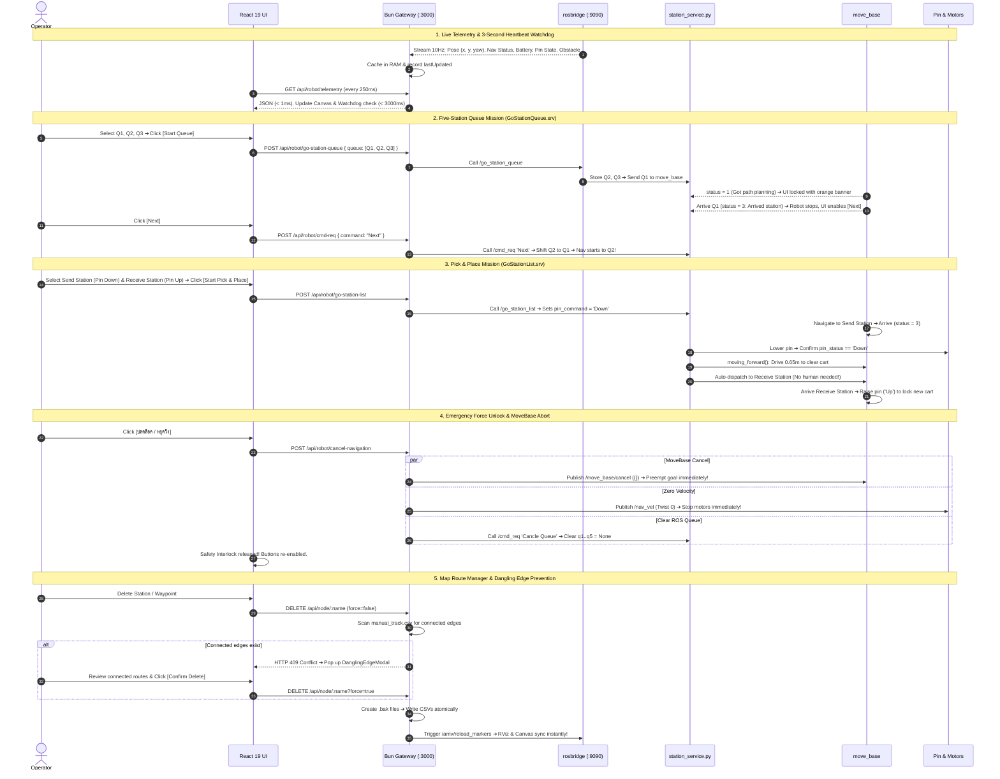

# AGV-001 Industrial Digital Twin & Autonomous Telemetry Gateway
**JOB260803 MEKTEC – Relayout AMR** | **MINIRW Co.,Ltd.**

เอกสารสรุปพิมพ์เขียวสถาปัตยกรรมทั้งระบบ (Full System Architecture Blueprint) ครอบคลุมทั้ง **System Flowchart**, **Sequence Diagrams (5 Scenarios)**, และ **Technology Stack** ที่พัฒนาเสร็จสมบูรณ์

---

## 1. Master System Flowchart (`Concept/flowchart.mmd`)

แสดงโครงสร้างของทั้ง 3 เลเยอร์หลัก: **Presentation Layer (React 19)**, **Gateway Layer (Pure Native Bun)**, และ **Robot System Layer (ROS Noetic on AMV2)**:

```mermaid
flowchart TD
    %% Presentation Layer
    subgraph PRESENTATION["🌐 Presentation Layer (React 19 UI - Port 3000)"]
        direction TB
        NAV["NavRail.tsx<br/>• View Mode Switcher<br/>• Dark/Light Theme<br/>• Offline Studio Control"]
        CANVAS["StationCanvas.tsx<br/>• 2D Canvas Engine (60 FPS)<br/>• Mektec Map Floorplan<br/>• Robot Pose (x, y, yaw)<br/>• Royal Blue Waypoints (#2563eb)<br/>• Track Layer Toggle (Default: OFF)<br/>• Target Locator Crosshair 🎯 [NodeName]"]
        INSPECTOR["InspectorPanel.tsx<br/>• Details Tab (Telemetry & Heartbeat)<br/>• 🎯 Single Mode (Go Station, Reset Pose)<br/>• 🔢 Queue Mode (Q1-Q5, Next, Cancel Queue)<br/>• 📦 Pick & Place Mode (Send Pin Down -> Receive Pin Up)<br/>• Hardware Interlock & Emergency Force Unlock"]
        ROUTEMGR["MapRouteManagerPane.tsx<br/>• 40/60 Split-View Dashboard<br/>• CRUD: Stations (12), Waypoints (18), Tracks (39)<br/>• DanglingEdgeModal.tsx (Prevents broken graph)"]
    end

    %% Gateway Layer
    subgraph GATEWAY["⚡ Gateway Layer (Pure Native Bun Server - Port 3000)"]
        direction TB
        BUN_ROUTER["src/index.ts (Pure Bun.serve)<br/>• Zero Frameworks (High Throughput)<br/>• Hot Module Reloading (HMR)<br/>• In-RAM Telemetry Cache (< 1ms)<br/>• Endpoints: /go-station, /go-station-queue, /go-station-list, /cmd-req, /cancel-navigation"]
        MAP_MGR["src/services/mapManager.ts<br/>• Atomic .bak Backup Generator<br/>• Thai Comment Stripper (# ช่วง...)<br/>• Dangling Edge Conflict Detector (HTTP 409)<br/>• ROS Marker Reload Trigger (/amv/reload_markers)"]
        ROS_BRIDGE["src/services/rosBridge.ts<br/>• Singleton WebSocket to ROS :9090<br/>• Auto-reconnect Loop (3s)<br/>• 5000ms Service Call Timeout<br/>• MoveBase Cancel Publisher & Zero Twist"]
        STORAGE[("Disk Storage (CSV Files & Map PNG)<br/>• station_list.csv<br/>• waypoint_follower_list.csv<br/>• manual_track.csv<br/>• mektec_20260917_remap.png")]
    end

    %% Robot Layer
    subgraph ROBOT["🤖 Robot System Layer (ROS Noetic on AMV2 - minirw@10.160.79.82)"]
        direction TB
        ROSBRIDGE_WS["rosbridge_server (Port 9090)<br/>WebSocket JSON-RPC Interface"]
        STATION_PY["amv_service (station_service.py)<br/>• GoStation, GoStationQueue, GoStationList<br/>• CommandNextStation ('Next', 'Cancle Queue')<br/>• Auto forward 0.65m on drop<br/>• Hardware Pin Controller"]
        MOVEBASE["move_base Action Server<br/>• Global & Local Path Planning<br/>• /move_base/cancel"]
        SENSORS["Sensors & Hardware Base<br/>• Laser Zone 1 Obstacle Detector<br/>• Base Status & Battery<br/>• Differential Drive Motors<br/>• Physical E-Stop"]
    end

    %% Connections
    PRESENTATION <===>|HTTP REST & 4Hz Polling| BUN_ROUTER
    BUN_ROUTER <---> MAP_MGR
    MAP_MGR <---> STORAGE
    BUN_ROUTER <---> ROS_BRIDGE
    ROS_BRIDGE <===>|Single Persistent WebSocket (:9090)| ROSBRIDGE_WS
    ROSBRIDGE_WS <===> STATION_PY
    STATION_PY <===> MOVEBASE
    MOVEBASE <===> SENSORS
```

---

## 2. Master Sequence Diagram (`Concept/sequence.mmd`)

แสดงกระบวนการทำงานจริง (Operational Execution Lifecycle) ทั้ง 5 สเต็ป:



---

## 3. Technology Stack Architecture (`Concept/stack.mmd`)

```mermaid
flowchart LR
    CLIENT["Client Devices<br/>Tablets / Laptops / HMI<br/>(Factory WiFi)"]
    FRONTEND["Frontend Stack (React 19)<br/>• Concurrent React 19<br/>• HTML5 2D Canvas Engine<br/>• Three.js 3D WebGL Digital Twin<br/>• Tailwind CSS v4 Industrial Themes"]
    GATEWAY["Gateway Runtime (Pure Bun)<br/>• Bun v1.2+ (Zig/C++)<br/>• Memory: 30-40 MB<br/>• In-RAM Telemetry Cache (< 1ms)<br/>• Atomic .bak Backup Engine"]
    ROS_ROBOT["Robot Stack (Ubuntu 20.04 + ROS Noetic)<br/>• rosbridge_server (Port 9090)<br/>• station_service.py<br/>• move_base Action Server<br/>• AMCL Localization<br/>• Hardware Base & Pin Actuators"]

    CLIENT <===>|HTTP / WS (:3000)| GATEWAY
    GATEWAY --- FRONTEND
    GATEWAY <===>|WebSocket (:9090) Localhost or WiFi| ROS_ROBOT
```
